

  <a href="https://comik.ai/?utm_source=github.com&utm_medium=directory&utm_campaign=listing_2026q4&utm_content=logo">
    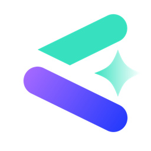
  </a>

<h1 align="center">Comik AI</h1>

  <b>Story-driven AI anime studio. Direct your anime story, shot by shot.</b> 
  Reusable characters · AI comics · Motion comics with voiced dialogue · AI Short Dramas

  <a href="https://comik.ai/?utm_source=github.com&utm_medium=directory&utm_campaign=listing_2026q4&utm_content=nav-home">Website</a> ·
  <a href="https://comik.ai/create?utm_source=github.com&utm_medium=directory&utm_campaign=listing_2026q4&utm_content=nav-create">Start creating</a> ·
  <a href="https://comik.ai/pricing?utm_source=github.com&utm_medium=directory&utm_campaign=listing_2026q4&utm_content=nav-pricing">Pricing</a> ·
  <a href="https://comik.ai/blog?utm_source=github.com&utm_medium=directory&utm_campaign=listing_2026q4&utm_content=nav-blog">Blog</a>

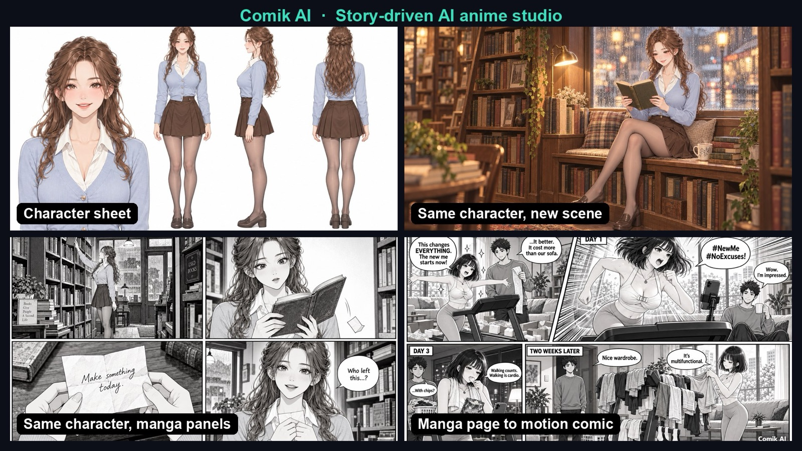

## What is Comik AI?

[Comik AI](https://comik.ai/?utm_source=github.com&utm_medium=directory&utm_campaign=listing_2026q4&utm_content=intro) is a story-driven **AI anime generator** that runs in the browser. Instead of starting over with every prompt, you build a cast of reusable characters and carry them through anime images, comic panels, video shots, and complete short dramas.

- **Design a character once.** Save it to your Assets and reuse it as a reference to keep the same face, hair, outfit, and colors across images, comics, and video.
- **Go from comic to motion comic.** Generate a 1–9 panel comic from your story, then open it in the Motion Comic Generator with **Animate Now**, or upload your own comic page.
- **Build an AI Short Drama.** Take an idea, script, or novel excerpt through script, characters, storyboard, and final cut in one Drama Studio project.

> This repository is the public product page for Comik AI. The product itself is a hosted web app at [comik.ai](https://comik.ai/?utm_source=github.com&utm_medium=directory&utm_campaign=listing_2026q4&utm_content=repo-note). There is no source code here.

## Features

### 1. Consistent characters you can reuse

The [Anime Character Creator](https://comik.ai/anime-character-creator?utm_source=github.com&utm_medium=directory&utm_campaign=listing_2026q4&utm_content=character-creator) turns a text prompt, with an optional reference image, into a multi-view **character sheet**: a bust portrait plus full-body front, side, and back views. The character is saved to your Assets automatically.

<table>
  <tr>
    <td>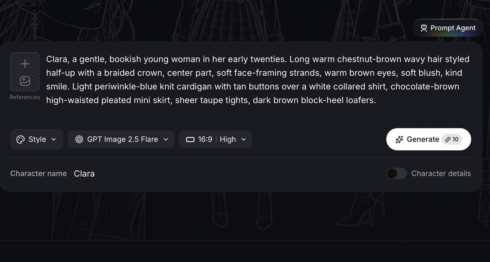</td>
    <td>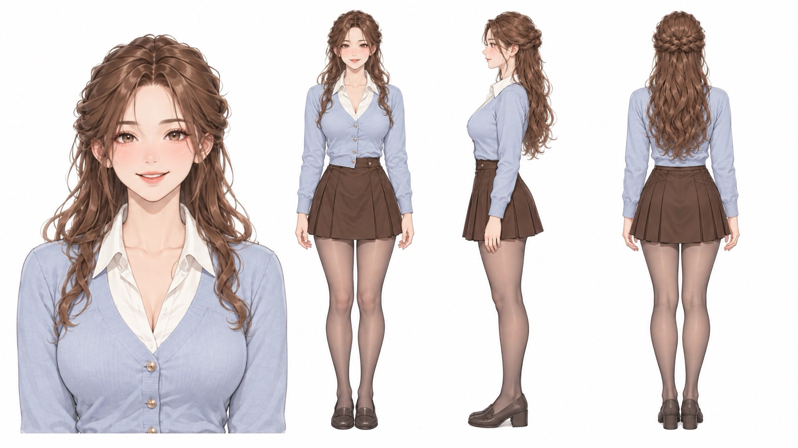</td>
  </tr>
  <tr>
    <td align="center">Describe the character and give it a name</td>
    <td align="center">Get a multi-view character sheet</td>
  </tr>
</table>

Pick the saved character from **My Assets** in any generator that accepts references. Comik AI keeps its face, hairstyle, outfit, and colors consistent unless your prompt asks for a change, while expression, pose, and camera follow each scene.

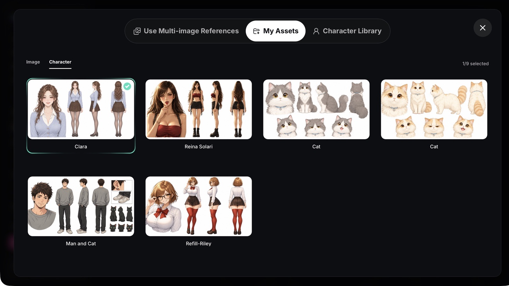

### 2. Anime images with your own characters

The [Anime Image Generator](https://comik.ai/anime-image-generator?utm_source=github.com&utm_medium=directory&utm_campaign=listing_2026q4&utm_content=image-generator) combines style presets, uploaded references, saved assets, and preset characters. Need a starting point? Browse [anime image templates](https://comik.ai/anime-image-templates?utm_source=github.com&utm_medium=directory&utm_campaign=listing_2026q4&utm_content=templates) for ready-made styles, poses, and prompts.

### 3. AI comics, panel by panel

The [AI Comic Generator](https://comik.ai/ai-comic-generator?utm_source=github.com&utm_medium=directory&utm_campaign=listing_2026q4&utm_content=comic-generator) creates one comic image with **1–9 panels** (or Auto). Choose one of six style presets (Manga, Anime, Webtoon, American Comic, Cartoon, Noir) or describe the look freely, then describe each panel's characters, action, setting, and dialogue.

<table>
  <tr>
    <td>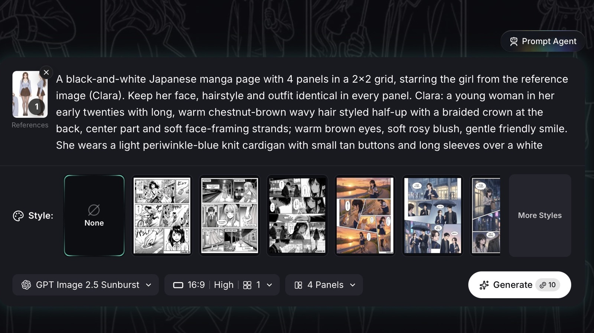</td>
    <td>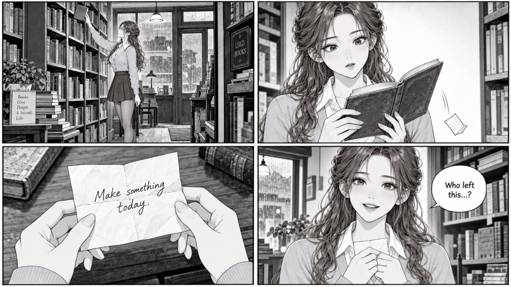</td>
  </tr>
  <tr>
    <td align="center">Reference the saved character, pick a style and panel count</td>
    <td align="center">A 4-panel manga with the same character</td>
  </tr>
</table>

### 4. Motion comics with voiced dialogue

The [AI Motion Comic Generator](https://comik.ai/motion-comic-generator?utm_source=github.com&utm_medium=directory&utm_campaign=listing_2026q4&utm_content=motion-comic) turns a single panel or a full comic, manga, or webtoon page into a motion comic.

- **Two ways in:** select **Animate Now** on a comic you generated, or upload your own panel or page.
- **Four animation styles:** Original Art, Auto Color, Multi-Panel Original Art, and Multi-Panel Auto Color. Multi-Panel styles play each panel as its own scene, in story order, as one continuous video.
- **Auto Color** colors black-and-white manga while it animates.
- **Voiced dialogue:** speech-bubble lines become spoken lines. Pick voices from the Voice Library and assign them to characters with `@` mentions, then add sound effects and background music.

<table>
  <tr>
    <td>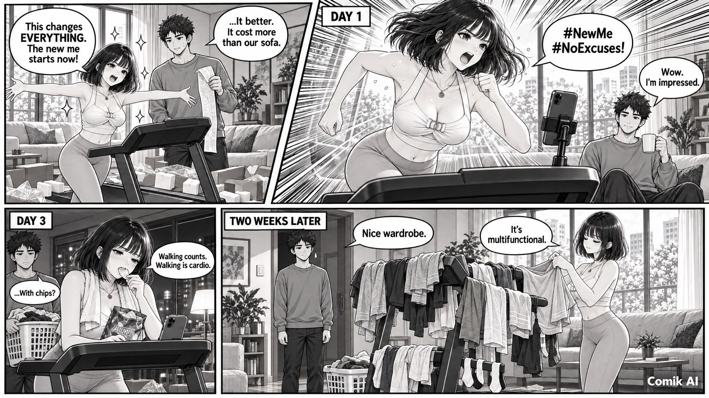</td>
    <td>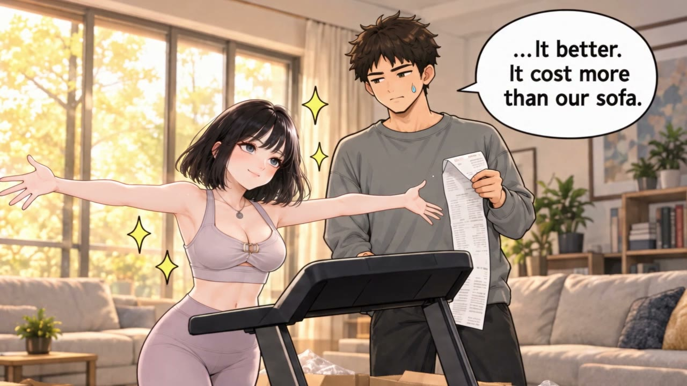</td>
  </tr>
  <tr>
    <td align="center">Input: a black-and-white manga page</td>
    <td align="center">Output: Multi-Panel Auto Color motion comic</td>
  </tr>
</table>

  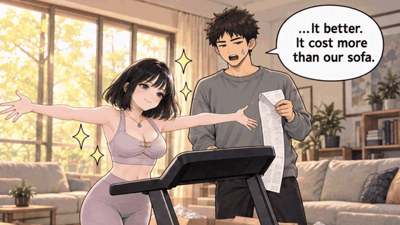

Each video covers one panel or one page. Maximum length depends on the model: up to 30 seconds with Seedance 2.5, 15 seconds with Seedance 2.0 and MiniMax H3, and 8 seconds with VEO 3.1.

### 5. Anime video shots

The [AI Anime Video Generator](https://comik.ai/ai-anime-video-generator?utm_source=github.com&utm_medium=directory&utm_campaign=listing_2026q4&utm_content=video-generator) creates anime-style clips from text, a first frame, first and last frames, or up to nine reference images on supported models such as Seedance 2.0. Reference a saved character, a scene image, and a voice in the same prompt.

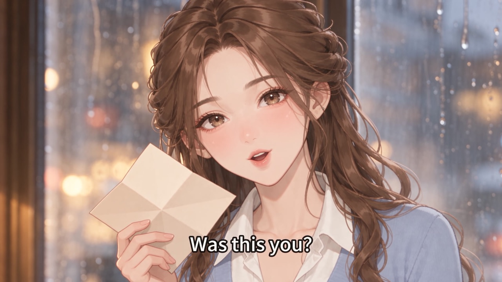

### 6. Drama Studio: from story to AI Short Drama

[AI Drama Studio](https://comik.ai/drama-studio?utm_source=github.com&utm_medium=directory&utm_campaign=listing_2026q4&utm_content=drama-studio) develops an idea, outline, script, or novel excerpt into one **AI Short Drama** of 15 seconds to 5 minutes, as a short video or a motion comic, in 9:16, 16:9, or 1:1.

1. **Outline & Script:** start from your source text, then write the script as timed cards.
2. **Characters:** generate or import characters and reuse them across episodes.
3. **Storyboard:** build each shot with a Shot Prompt, a keyframe, and scene or prop references, then generate video takes with sound.
4. **Video Cuts:** trim, split, change speed, adjust volume and fades, add your own clips, and export an MP4.

### 7. Prompt Agent

The built-in Prompt Agent turns rough ideas into clear image, comic, and video prompts, scripts, and shot directions, so you don't need to be a prompt engineer to get usable results.

## Workflow: from story to motion comic

No drawing skills needed:

1. Create a character in the [Anime Character Creator](https://comik.ai/anime-character-creator?utm_source=github.com&utm_medium=directory&utm_campaign=listing_2026q4&utm_content=workflow-character).
2. Generate a 1–9 panel comic in the [AI Comic Generator](https://comik.ai/ai-comic-generator?utm_source=github.com&utm_medium=directory&utm_campaign=listing_2026q4&utm_content=workflow-comic), using the saved character as a reference.
3. Select **Animate Now** to open the comic in the [Motion Comic Generator](https://comik.ai/motion-comic-generator?utm_source=github.com&utm_medium=directory&utm_campaign=listing_2026q4&utm_content=workflow-motion-comic).
4. Choose Multi-Panel Original Art or Multi-Panel Auto Color, assign voices with `@`, and generate.

Both the comic and the motion comic use credits, and motion comics require a paid plan.

## Supported models

| Type | Models |
|---|---|
| Video | Seedance 2.5, Seedance 2.0, MiniMax H3, VEO 3.1 |
| Image | GPT Image 2.5 (Flare / Sunburst), GPT Image 2, Nano Banana 2.1, Nano Banana 2, Nano Banana Pro |

Model availability depends on your plan. These are third-party models offered inside Comik AI.

## Tips for keeping a character consistent

These rules come from building the Clara example above, and they apply to most image and video models that accept reference images:

- **Make a character sheet first.** Front, side, and back views give the model something to check against when the camera angle changes.
- **Reuse one description block.** Paste the same appearance description into the image, comic, and video prompts.
- **Say what not to do.** For example, "no character-sheet panels" prevents the sheet layout from leaking into scenes.
- **Give references fixed roles.** Image 1 is always the character; Image 2 is the scene.
- **Spell out every visible word.** Speech bubbles, notes, and subtitles.
- **Name outfit changes explicitly** when you want them; otherwise the saved design is kept.

References improve consistency, but they don't guarantee identical results every time. When something drifts, adjust the prompt and regenerate.

The full walkthrough, with the exact prompts and settings, is on [DEV Community](https://dev.to/nland_s_297ce2e4f4418ae00/how-i-keep-one-ai-anime-character-consistent-across-images-comics-and-video-with-the-exact-1jk6). It is also available in [Japanese on note](https://note.com/mute_nland139/n/nfb0505d2646d) and [Korean on velog](https://velog.io/@nlands7/AI-애니메이션-캐릭터-하나를-이미지만화영상에서-일관되게-쓰는-방법-실제-프롬프트-공개).

## Demo videos

<a href="https://www.youtube.com/watch?v=-yzreU_JEFg">
  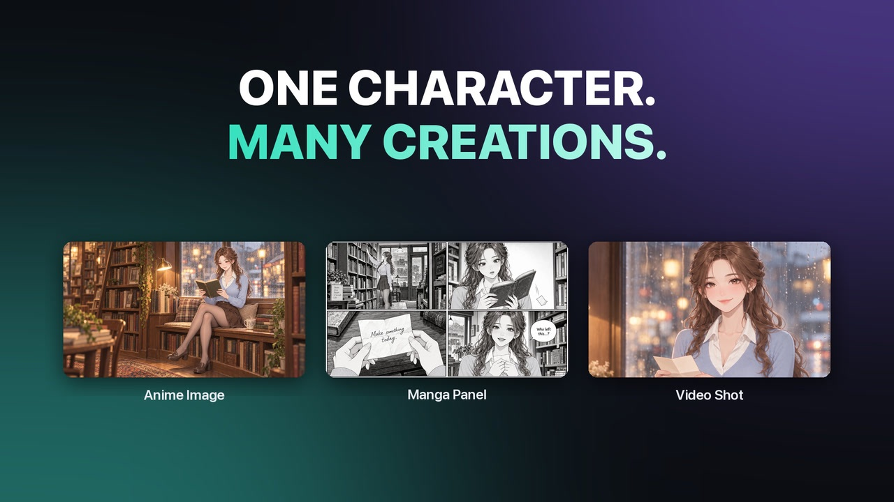
</a>

- [One character across an anime image, manga panels, and a video shot](https://www.youtube.com/watch?v=-yzreU_JEFg) (30 seconds)
- [Motion comic demo](https://www.youtube.com/watch?v=gtvNF0nYLo0)

## Pricing

- **Free:** 10 one-time welcome credits, no credit card required, Free-tier models. Credits don't refill monthly.
- **Paid plans:** start at $11.90/month and unlock all image and video models, including video and motion comic generation.

Credits are used per generation and vary by model, type, duration, and settings. See [Comik AI pricing](https://comik.ai/pricing?utm_source=github.com&utm_medium=directory&utm_campaign=listing_2026q4&utm_content=pricing) for current plans.

## Who it's for

- **Indie comic and webtoon creators** turning finished pages into motion comics and trailers for TikTok, YouTube Shorts, and Instagram Reels.
- **Manga artists** who want to auto-color black-and-white pages and give characters voices without animating frame by frame.
- **Storytellers who don't draw**, generating a comic from a story and turning it into a motion comic.
- **Writers and web novelists** adapting a chapter or script into an AI Short Drama, shot by shot.
- **OC artists, VTubers, and TRPG players** designing original characters and character sheets.
- **Anime story channels** reusing the same characters across episodes.

## Languages

English, Japanese, Korean, Portuguese, Simplified Chinese, and Traditional Chinese.

## FAQ

**Is Comik AI free?**
You can start free with 10 one-time credits and no credit card. Video and motion comic generation are available on paid plans.

**Can I animate my own comic or manga?**
Yes. Upload a single panel or a full page to the [motion comic maker](https://comik.ai/motion-comic-generator?utm_source=github.com&utm_medium=directory&utm_campaign=listing_2026q4&utm_content=faq-upload). Only upload work you own or have permission to use.

**Can I use what I create commercially?**
Subject to the Terms of Service, you may use the outputs you create. You are responsible for having the rights to anything you upload and for clearing any rights before you publish or use outputs commercially.

**Who can use Comik AI?**
Comik AI is for users aged 18 and over.

## Links

- Website: [comik.ai](https://comik.ai/?utm_source=github.com&utm_medium=directory&utm_campaign=listing_2026q4&utm_content=links)
- Blog: [Best AI Motion Comic Generators](https://comik.ai/blog/best-ai-motion-comic-generators?utm_source=github.com&utm_medium=directory&utm_campaign=listing_2026q4&utm_content=links-blog)
- Support: support@comik.ai

---

© 2026 Comik AI All rights reserved.
